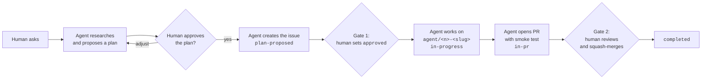

<!-- omit from toc -->
# Human-in-the-loop process

> **AI supports, humans decide.** Agents research, propose and execute. Humans approve every plan and every merge.

This is the default way of working in this repository. It also serves as the starting point for the teams you work with.

<!-- omit from toc -->
## Table of Contents

- [Lifecycle](#lifecycle)
- [The two human gates](#the-two-human-gates)
- [Label keys](#label-keys)
- [Automation](#automation)
- [After a merge](#after-a-merge)
- [The issue is the source of truth](#the-issue-is-the-source-of-truth)
- [Branches, commits and pull requests](#branches-commits-and-pull-requests)
- [Smoke tests](#smoke-tests)

## Lifecycle

| Step | Who | What happens |
| ---- | --- | ------------ |
| 1 | Human | Asks a question or states a need in chat. |
| 2 | Agent | Researches and proposes a plan in chat. Open questions and suggestions are part of the proposal. |
| 3 | Human | Reviews the plan. The agent adjusts it until it is approved. |
| 4 | Agent | Creates a GitHub issue from the issue form with the approved plan and the label key `plan-proposed`. |
| 5 | Human | **Gate 1.** Sets `approved` on the issue, manually or by asking the agent to do it in the current chat. |
| 6 | Agent | Proposes a branch, does the work, sets `in-progress` and reports back. |
| 7 | Agent | Offers a smoke test script, opens a pull request that closes the issue and sets `in-pr`. |
| 8 | Human | **Gate 2.** Reviews the pull request and squash-merges it. The issue gets `completed`. |

## The two human gates

- **Gate 1, plan approval.** No work starts without `approved`. An agent never sets `approved` on its own initiative.
  It sets it only when a human asks for that in the current chat.
- **Gate 2, merge.** The agent cannot merge. The ruleset requires a pull request with one human approval, and pull
  requests are squash-merged only. See [rulesets.md](./rulesets.md).

## Label keys

Agents and workflows act on the stable `key` of a label, never on its title. Consumers can therefore rename labels freely.
The default set is [templates/github/other/github-labels.jsonc](../../templates/github/other/github-labels.jsonc).

| Key | Meaning | Set by |
| --- | ------- | ------ |
| `needs-triage` | New item, not yet looked at. | Issue form |
| `plan-proposed` | The agent proposed a plan that waits for review. | Agent |
| `approved` | A human approved the plan; work may start. | **Human only** |
| `todo` | Approved work that has not started. | Workflow |
| `in-progress` | Work has started on a branch. | Agent or workflow |
| `in-pr` | A pull request is open for the issue. | Agent or workflow |
| `completed` | The pull request was merged. | Workflow |
| `on-hold` | Paused until further notice. | Human |
| `long-term` | Will take a longer time. | Human |

The remaining keys (`bug`, `chore`, `documentation`, `enhancement`, `question` and so on) classify the work.

> [!NOTE]
> The `Set-GitHubLabels` command of the `MSCKite.Azure.Platform` module identifies labels by `name`. Renaming a label in your
> label file therefore creates the new label and removes the old one, and issues lose the old association. Always run it with
> `-WhatIf` first. Matching by `key` in the module is a planned follow-up in `az-platform-kite`.

## Automation

Two workflows keep the status labels current. Both resolve labels from the label file by key
(`.github/scripts/Get-LabelMap.ps1`), so renamed labels keep working. Set the repository variable `LABEL_FILE` when your label file
is not at `templates/github/other/github-labels.jsonc`.

| Workflow | Trigger | Effect |
| -------- | ------- | ------ |
| [issue-status.yaml](../../.github/workflows/issue-status.yaml) | Pull request opened | Linked issues (`Closes #n`): remove `todo` and `plan-proposed`, set `in-progress` and `in-pr`. |
| | Pull request merged | Remove `todo`, `in-progress` and `in-pr`, set `completed`. |
| | Pull request closed without merge | Set `in-progress`, remove `in-pr` and comment. |
| | Issue reopened | Remove `completed`, set `todo`. |
| [approval-guard.yaml](../../.github/workflows/approval-guard.yaml) | `approved` label set | Removes it and comments when a bot set it, or when the issue has no `plan-proposed`. |

The approval guard is a safety net that reacts after the label is set. It runs only when the repository variable
`APPROVAL_GUARD_ENABLED` is `true`. Enable it once the agent works as the GitHub App, because before that the agent uses a human
login and the guard cannot tell them apart.

> [!NOTE]
> Workflows that use the default `GITHUB_TOKEN` do not trigger other workflows. The label changes above therefore do not start
> any further automation.

## After a merge

After a human merges, nothing in the pull request cleans up a local clone, and the remote branch is only deleted when the
repository setting **Automatically delete head branches** is on (`delete_branch_on_merge`; turn it on for every repository).
When a human tells the agent that a pull request is merged, the agent:

1. Switches to the default branch and fast-forwards it (`git pull --ff-only`).
2. Deletes the local branch of the pull request and prunes remote references (`git fetch --prune`).
3. Confirms the remote branch is gone (`git ls-remote --heads origin <branch>` shows nothing).
4. Checks the issue: it is closed and carries `completed`, without `in-progress` or `in-pr`. It corrects the labels if the
   workflow did not, and says so.
5. Proposes the next step from the queue of issues labeled `plan-proposed` or `approved`.

## The issue is the source of truth

The issue is where the team and the agents read the status and the decisions. Keep it current:

- The **Proposed plan** is the approved plan. If the plan changes during the work, the agent updates it and adds a line to the
  decision log, and a human re-approves when the change is more than cosmetic.
- The **Decision log** lists every decision with the date and who made it, human or agent.
- The **status** is the set of label keys above, not text in the description.

## Branches, commits and pull requests

- Agents work only on branches named `agent/<issue-number>-<slug>`, for example `agent/1-process-docs`.
- Commit and pull request titles are Conventional Commits: `<type>: <Capitalized summary>`.
  The pull request title becomes the commit title on `main`.
- The pull request description closes the issue (`Closes #1`) and contains the smoke test.
- Agent commits carry a `Co-Authored-By` line, see [agent-identity.md](./agent-identity.md).

## Smoke tests

Every change comes with a smoke test a human can run to prove the change behaves as expected. The agent states the command and
the expected result in the issue and in the pull request. Prefer a small PowerShell or Bash script over a description.
